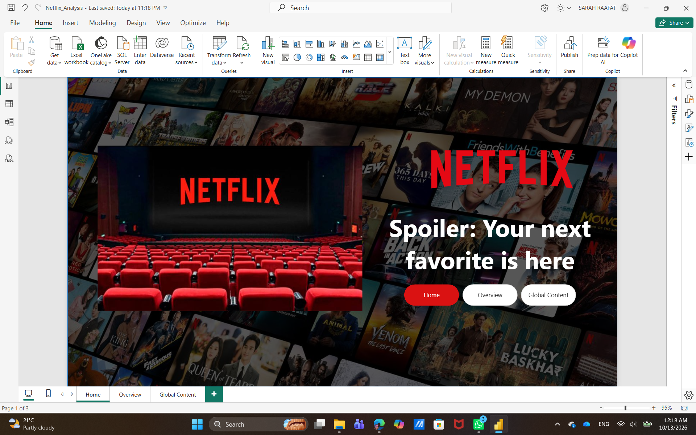
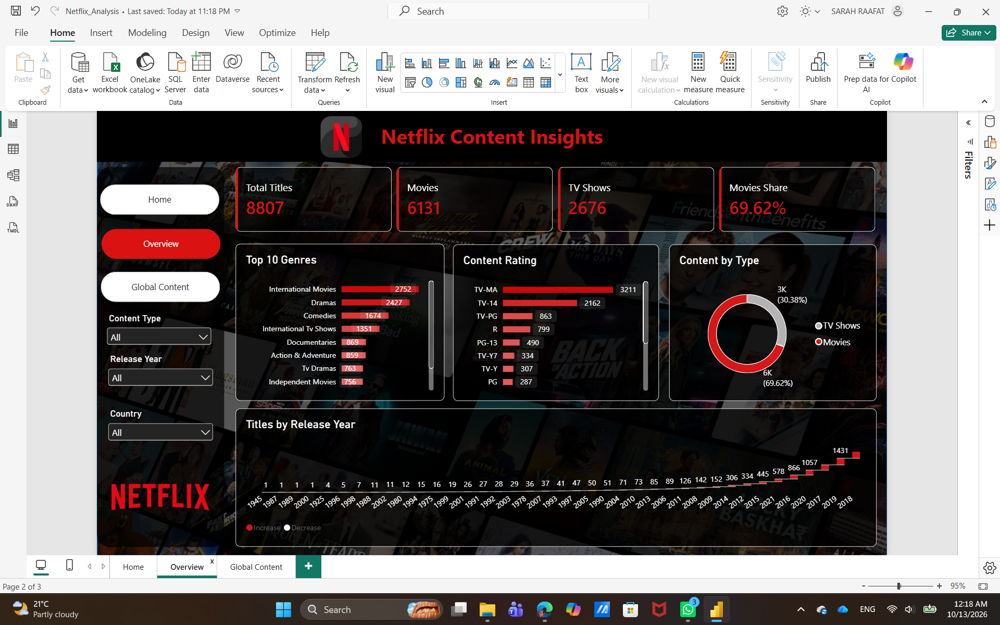
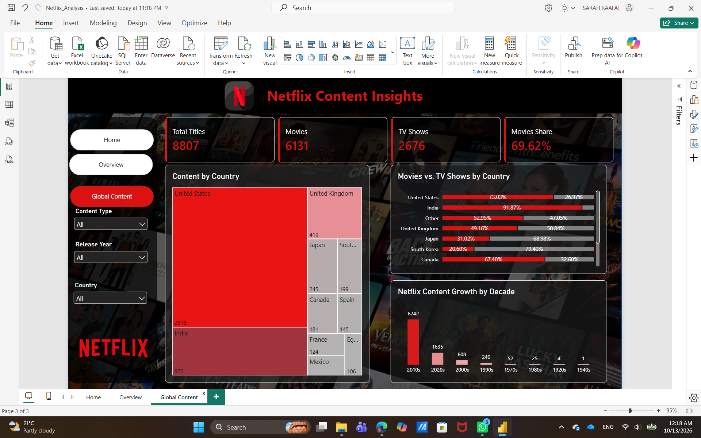

# 🎬 Netflix Content Analysis | Power BI

## 📌 Project Overview

This project explores Netflix's content catalog using Power BI to analyze the distribution of movies and TV shows, content ratings, genres, countries, and release trends.

The project transforms raw data into an interactive dashboard to uncover patterns in Netflix's content library and present findings through clear and meaningful visualizations.

## 🎯 Project Objectives

- Analyze the distribution of Movies and TV Shows.
- Explore the most common content ratings.
- Identify the leading genres by number of titles.
- Examine content distribution across countries.
- Analyze content release trends over time.
- Present insights through interactive Power BI dashboards.

## 🛠️ Tools & Technologies

- **Power BI Desktop** — Dashboard development and data visualization.
- **Power Query** — Data cleaning and transformation.
- **DAX** — Measures and analytical calculations.
- **Data Modeling** — Organizing data for analysis.
- **Data Visualization** — Presenting trends and patterns.

## 🧹 Data Preparation

The dataset was prepared for analysis through the following steps:

- Reviewed the dataset structure and data types.
- Cleaned and transformed selected columns using Power Query.
- Examined missing values in fields such as country, director, and cast.
- Prepared the data for analysis and visualization.
- Organized the data model to support the dashboard's analytical requirements.

## 📊 Dashboard Preview

### Dashboard Home

### Content Analysis

### Country Analysis

## 💡 Business Questions

This project explores the following questions:

1. What is the distribution of Movies and TV Shows on Netflix?
2. Which content ratings appear most frequently?
3. Which genres have the highest number of titles?
4. How is Netflix content distributed across countries?
5. How have content releases changed over time?
6. What patterns can be identified in Netflix's content catalog?

## 📈 Key Analytical Areas

- **Content Distribution:** Comparing Movies and TV Shows.
- **Content Ratings:** Examining the distribution of ratings.
- **Genre Analysis:** Identifying the most common genres.
- **Geographical Analysis:** Exploring content distribution by country.
- **Release Trends:** Analyzing content across different years and decades.

## 📁 Project Files

| File | Description |
|---|---|
| `Netflix_Analysis.pbix` | Power BI report |
| `Netflix_Dashboard.png` | Dashboard screenshot |
| `Netflix_Dashboard1.png` | Dashboard screenshot |
| `Netflix_Dashboard2.png` | Dashboard screenshot |

## 🧠 Skills Demonstrated

- Data Cleaning and Transformation
- Data Modeling
- DAX Measures
- KPI Development
- Interactive Dashboard Design
- Exploratory Data Analysis
- Data Visualization
- Analytical Thinking and Data Storytelling

## 👩‍💻 Author

**Sara Raafat**  
Business Information Systems Student | Aspiring Data Analyst

- **GitHub:** [sararaafatmohamed-cmd](https://github.com/sararaafatmohamed-cmd)
- **LinkedIn:** [Sara Raafat](https://www.linkedin.com/in/sarah-raafat-639a88259)

---

*This project was developed as part of my data analysis learning journey, with a focus on Power BI, data preparation, and interactive reporting.*
