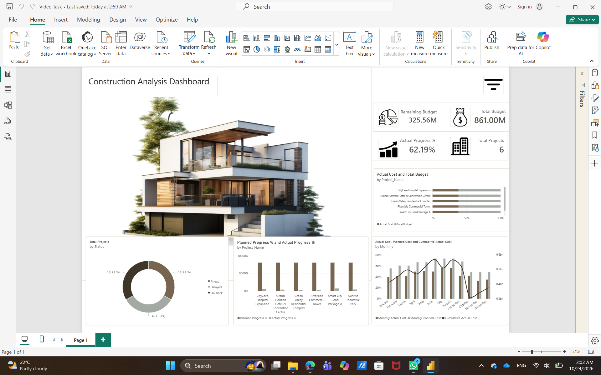

# Project Management Dashboard | Power BI

## 📌 Project Overview

This project is a Power BI practice project focused on analyzing project budgets, expenses, and progress through an interactive dashboard.

I developed this dashboard while following a YouTube tutorial as part of my hands-on learning journey in data analytics and business intelligence.

## 🎯 Project Objectives

- Monitor the total number of projects.
- Analyze total and remaining budgets.
- Track actual and planned project progress.
- Analyze monthly planned costs and actual expenses.
- Visualize project performance indicators in an interactive dashboard.

## 🛠️ Tools & Technologies

- **Power BI Desktop** — Dashboard development and visualization.
- **DAX** — Measures and calculations.
- **Data Modeling** — Working with multiple related tables.
- **Power BI Themes** — Dashboard styling and customization.

## 📊 Key Measures

- Total Projects
- Total Budget
- Actual Cost
- Remaining Budget
- Budget Utilization %
- Actual Progress %
- Planned Progress %
- Progress Variance %
- Monthly Planned Cost
- Cumulative Actual Cost

## 🎨 Dashboard Preview

## 📚 Key Learning Outcomes

- Practiced writing DAX measures.
- Worked with relationships between data tables.
- Analyzed project budgets, expenses, and progress.
- Practiced designing and formatting Power BI visuals.
- Applied a custom color palette to improve dashboard presentation.

## 🔗 Learning Resource

This project was developed while following this YouTube tutorial:

[Power BI Project Management Dashboard Tutorial](https://www.youtube.com/watch?v=XIHmMvlaI4g)

## 📁 Project Files

- `Video_task.pbix` — Power BI project file.
- `Dashboard.png` — Dashboard preview.

## 👩‍💻 Author

**Sara Raafat**

Aspiring Data Analyst | SQL | Power BI | Data Visualization
