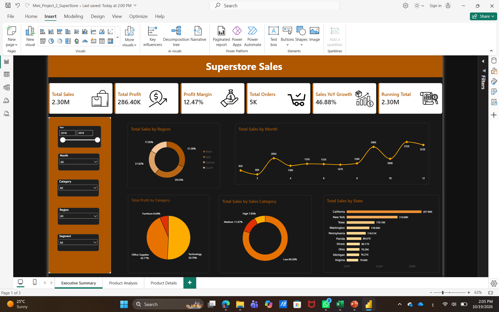
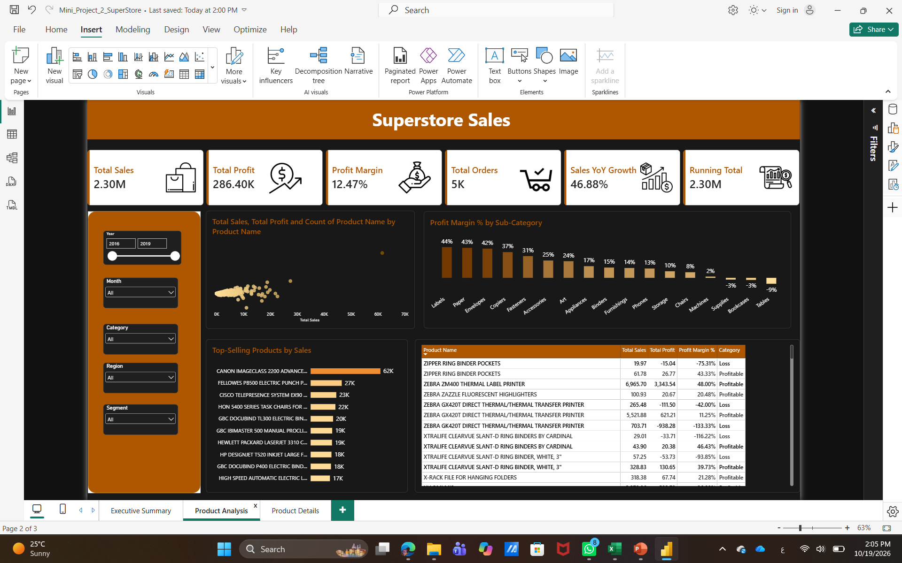

# 🛒 Superstore Sales Analysis — Power BI

## 📌 Project Overview

This project focuses on analyzing Superstore sales data using Microsoft Power BI. It was developed as part of a mini-project to practice data preparation, data modeling, DAX calculations, and interactive reporting.

The main objective is to transform raw sales data into an interactive report that helps management monitor business performance, evaluate product profitability, and analyze shipping efficiency.

## 🎯 Business Objectives

- Monitor overall sales and profit performance.
- Calculate key performance indicators (KPIs).
- Analyze profit margins and year-over-year growth.
- Track cumulative sales over time.
- Evaluate product profitability.
- Analyze shipping delays.
- Enable interactive exploration of business data.

## 🛠️ Tools & Technologies

- **Microsoft Power BI** — Report development and data visualization.
- **Power Query Editor** — Data cleaning and transformation.
- **DAX (Data Analysis Expressions)** — Measures and calculated columns.
- **Data Modeling** — Table relationships and date hierarchy.

## ⚙️ Project Workflow

### 1. Data Preparation

- Imported the Superstore dataset into Power BI.
- Cleaned and transformed the data using Power Query Editor.
- Prepared the dataset for analysis and reporting.

### 2. Data Modeling

- Created a data model to support analytical reporting.
- Organized date fields to enable time-based analysis.
- Created a date hierarchy for analyzing performance across different time periods.

### 3. DAX Measures

The project focuses on creating measures to calculate business performance indicators, including:

- **Total Sales** — Calculates total sales revenue.
- **Total Profit** — Calculates overall profit.
- **Profit Margin %** — Measures profit relative to sales.
- **Running Total** — Tracks cumulative performance over time.
- **Year-over-Year Growth** — Evaluates performance changes compared with the previous year.

### 4. Calculated Columns

- **Profitability Category** — Classifies records based on profitability.
- **Shipping Delay** — Identifies shipping delays using relevant order and shipping dates.

### 5. Interactive Report Development

The report includes two analytical pages:

**Executive Analysis**
- High-level business performance monitoring.
- Key performance indicators.
- Sales and profit analysis.
- Time-based performance evaluation.

**Product Analysis**
- Product-level performance analysis.
- Sales and profitability comparisons.
- Interactive filtering to explore product results.

### 6. Interactive Features

- Slicers for filtering report data.
- Interactive visuals for exploring business performance.
- Dynamic filtering across relevant report visuals.
- Drill-through functionality for more detailed analysis.

## 📊 Dashboard Preview

### Executive Analysis

### Product Analysis

## 📁 Project Files

| File | Description |
|---|---|
| `Mini_Project_2_SuperStore.pbix` | Power BI report containing the project analysis and dashboards. |
| `Superstore_Report_Simple.docx` | Supporting project report. |
| `SuperStore_Dashboard.png` | Dashboard screenshot — executive analysis page. |
| `SuperStore_Dashboard_1.png` | Dashboard screenshot — product analysis page. |

## 📈 Skills Demonstrated

- Data Cleaning and Transformation
- Power Query
- Data Modeling
- DAX Measures
- Calculated Columns
- KPI Development
- Time-Based Analysis
- Interactive Dashboard Design
- Business Performance Analysis

## 🎓 Learning Outcomes

Through this project, I practiced applying Power BI features to a real-world-style retail dataset. The project strengthened my understanding of data preparation, analytical calculations, interactive reporting, and translating business requirements into measurable performance indicators.

## 👩‍💻 Author

**Sara Raafat**

Business Information Systems Student | Aspiring Data Analyst

**Tools:** Power BI | Power Query | DAX | SQL | Excel

---

*This project was developed for educational purposes as part of my data analysis learning journey.*
