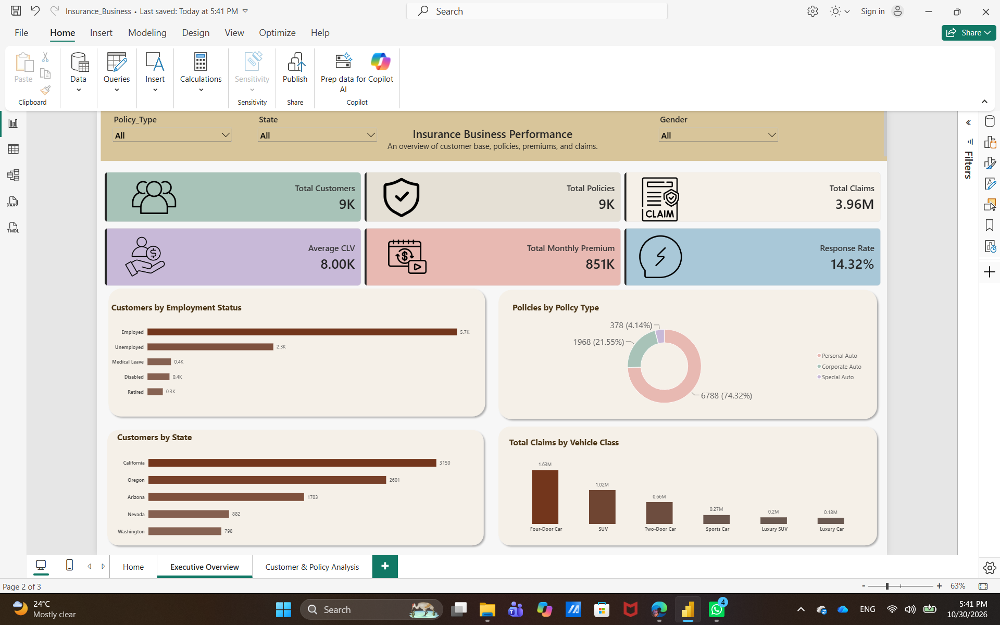
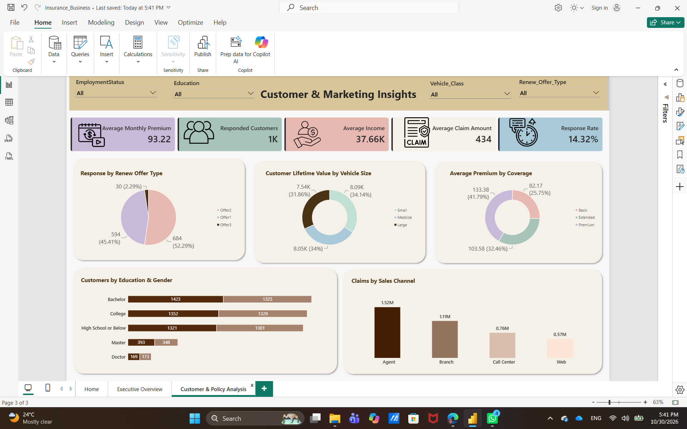
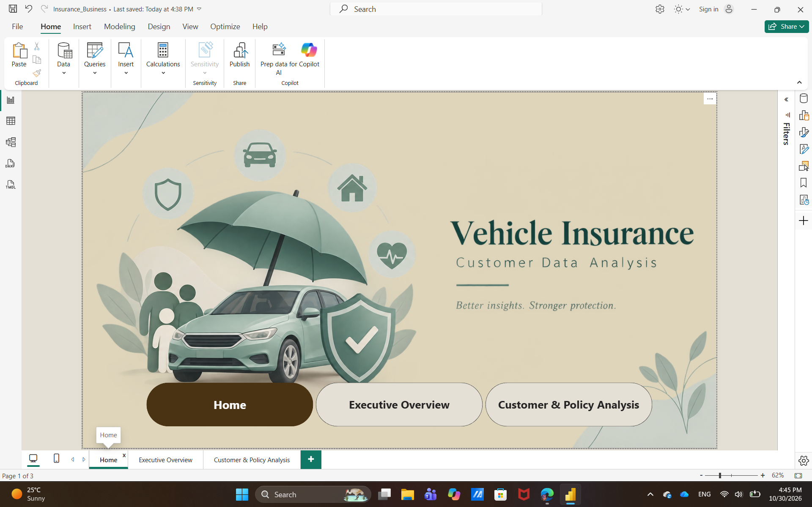

# Vehicle Insurance Data Analysis

An end-to-end data analysis project focused on exploring vehicle insurance customer data, analyzing policy distribution, evaluating claim amounts, and understanding customer responses to marketing offers using SQL Server and Power BI.

## Project Overview

The project aims to transform raw vehicle insurance data into meaningful business insights that help understand customer behavior, evaluate insurance policies, analyze claims, and assess marketing campaign performance.

## Business Questions

- Which states have the largest customer base?
- What are the most common insurance policy types?
- Which vehicle classes have the highest claim amounts?
- What are the main customer characteristics?
- How do customers respond to different marketing offers?
- Which sales channels record the highest claim amounts?

## Tools & Technologies

- **Power Query:** Data cleaning and transformation.
- **SQL Server:** Database creation, data storage, and SQL queries.
- **Power BI:** Data modeling, DAX measures, and interactive dashboards.

## Data Model

The database is organized into four tables:

**Dimension Tables**
- Dim_Customer
- Dim_Policy
- Dim_Date

**Fact Table**
- Fact_Insurance

The tables are connected through relationships to support structured and efficient analysis.

## Data Analysis Process

1. Imported and explored the raw dataset.
2. Cleaned and transformed the data using Power Query.
3. Split the dataset into dimension and fact tables.
4. Created the database and imported the prepared tables into SQL Server.
5. Connected SQL Server to Power BI.
6. Created relationships and DAX measures.
7. Designed interactive dashboards to analyze business performance.

## Dashboard Preview

### 1. Executive Overview

Provides an overview of the company's customer base, policies, premiums, and claims.

### 2. Customer & Marketing Insights

Focuses on customer characteristics, premiums, claims, and marketing campaign responses.

### Additional Dashboard Screenshot

## Key Insights

- California has the largest customer base, with approximately 3,150 customers.
- Personal Auto is the dominant policy type, representing 74.32% of policies.
- Four-Door Cars record the highest total claim amount, reaching approximately 1.63M.
- The overall marketing response rate is 14.32%.
- Offer 2 accounts for the largest share of responses at 52.29%.
- The Agent sales channel records the highest total claim amount, at approximately 1.52M.

## Project Files

- **Power BI Dashboard:** `PowerBI/Insurance_Business.pbix`
- **SQL Database Script:** `SQL/InsuranceDB.sql`
- **Presentation:** `Presentation/Vehicle Insurance Data Insights_compressed.pdf`
- **Dashboard Screenshots:** `Screenshots/`

## Conclusion

This project demonstrates how SQL Server, Power Query, and Power BI can be used together to clean, organize, analyze, and visualize insurance data.

The interactive dashboards provide useful insights into customer distribution, policy performance, claims, and marketing responses to support data-driven business decisions.
